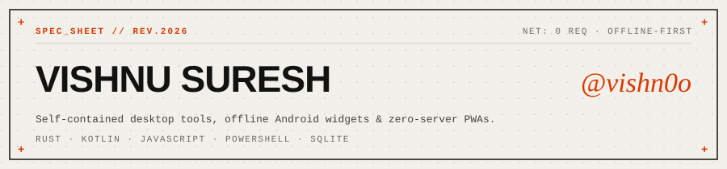
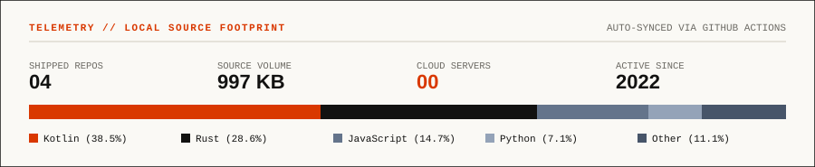

<div align="center">
  <picture>
    <source media="(prefers-color-scheme: dark)" srcset="./assets/banner-dark.svg" />
    <source media="(prefers-color-scheme: light)" srcset="./assets/banner-light.svg" />
    
  </picture>
</div>

<p align="center">
  <code>MANIPAL / KERALA, IN</code> &nbsp;·&nbsp;
  <code>DISCIPLINE: LOCAL-FIRST ENGINEERING</code> &nbsp;·&nbsp;
  <code>CLOUD SERVERS: 00</code>
</p>

<p align="center">
  <a href="https://vishn0o.github.io"><b>↗ Live Specimen Workbench</b></a> &nbsp;·&nbsp;
  <a href="https://github.com/vishn0o?tab=repositories"><b>↗ All Repositories</b></a> &nbsp;·&nbsp;
  <a href="mailto:sureshvishnupv@protonmail.com"><b>↗ Signal / Email</b></a>
</p>

<br />

### `01 // ENGINEERING THESIS`

> **Software should live on your hardware and work with the Wi-Fi off.**

I’m **Vishnu Suresh** (`@vishn0o`) — a Cyber Physical Systems undergraduate at **MIT Manipal** building self-contained desktop utilities, offline Android widgets, and zero-server web tools. Every system below is backed by local **SQLite**, **Room**, or plain files — no cloud accounts, no telemetry, and no external servers to shut down.

<br />

### `02 // SHIPPED SPECIMENS`

<!-- SPECIMENS:START -->
<table>
  <thead>
    <tr>
      <th align="left">ID</th>
      <th align="left">SPECIMEN</th>
      <th align="left">ARCHITECTURE &amp; FOOTPRINT</th>
      <th align="left">SURFACE</th>
    </tr>
  </thead>
  <tbody>
    <tr>
      <td><code>01</code></td>
      <td><a href="https://github.com/vishn0o/cat-water-reminder"><b>Cat Water Reminder</b></a></td>
      <td>Windows tray cat that nags you to hydrate - repeating &amp; one-shot reminders, transparent popup, ~13 MB resident. PowerShell/WinForms, no dependencies.</td>
      <td><code>Python · PowerShell · Shell</code></td>
    </tr>
    <tr>
      <td><code>02</code></td>
      <td><a href="https://github.com/vishn0o/InkyNerd"><b>InkyNerd</b></a></td>
      <td>Local-first open-source software specimen.</td>
      <td><code>Kotlin · Compose · Room</code></td>
    </tr>
    <tr>
      <td><code>03</code></td>
      <td><a href="https://github.com/vishn0o/KathaShelf"><b>KathaShelf</b></a></td>
      <td>Local-first desktop book tracker for Malayalam &amp; English libraries, built with Rust and egui</td>
      <td><code>Rust · egui · SQLite</code></td>
    </tr>
    <tr>
      <td><code>04</code></td>
      <td><a href="https://github.com/vishn0o/study-hub"><b>Study Hub</b></a></td>
      <td>Offline study tracker - upload a study PDF from any AI agent and track topics, questions and predicted scores. All local, no server, no accounts.</td>
      <td><code>JavaScript · CSS · HTML</code></td>
    </tr>
  </tbody>
</table>
<!-- SPECIMENS:END -->

<br />

### `03 // TECHNICAL MATRIX & INSTRUMENTATION`

```text
SYSTEMS & NATIVE      Rust (egui, rusqlite, reqwest) · Kotlin (Jetpack Compose, Room, WorkManager) · C++
WEB & LOCAL-FIRST     Vanilla JavaScript · HTML5 / CSS3 · Service Workers / PWA · Vendored PDF.js & KaTeX
AUTOMATION & SHELL    PowerShell · Bash · Windows WinForms · GitHub Actions CI/CD
```

<br />

### `04 // TELEMETRY & LANGUAGE FOOTPRINT`

<div align="center">
  <picture>
    <source media="(prefers-color-scheme: dark)" srcset="./assets/stats-dark.svg" />
    <source media="(prefers-color-scheme: light)" srcset="./assets/stats-light.svg" />
    
  </picture>
</div>

<br />

<div align="center">
  <sub><code>SPEC_SHEET // REV.2026</code> &nbsp;·&nbsp; <code>ZERO EXTERNAL RUNTIME DEPENDENCIES</code> &nbsp;·&nbsp; <code>UID: 115354932</code></sub>
</div>
